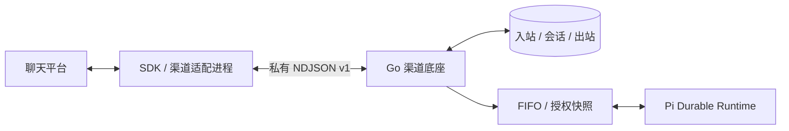

# 渠道适配器开发与安装

平台渠道底座只处理标准化入站、会话、Agent 任务和出站状态。每个适配器负责厂商 SDK、连接维护、消息格式和回执分类。内置企微机器人运行在独立 Node 进程，与模型 Runtime 分开。



`internal/channels` 定义 `Provider`、`Connection`、`Incoming`、`Delivery` 和注册表；`internal/platform/channel_core.go` 复用业务队列与持久化；`channels.go` 提供统一管理 API。适配器不需要接触平台数据库或实现 Agent 引擎。

## 安装包

额外适配器安装在数据目录的 `channel-adapters/<package>/`，包含 `adapter.json`、已准备好的 Node 入口和所需依赖。当前从本地可信目录在启动时发现；安装后重启整个服务，新类型会出现在“新增渠道”中。没有 Web 任意包下载或执行安装脚本的接口。清单或入口损坏的额外包会被跳过并记录固定错误说明，其余适配器与平台仍正常启动。

示例清单：

```json
{
  "v": 1,
  "entry": "worker.mjs",
  "provider": {
    "id": "example-chat",
    "name": "Example Chat",
    "description": "通过 SDK 长连接接收文字消息。",
    "documentation": "https://example.com/docs",
    "transport": "websocket",
    "identity_fields": ["account"],
    "max_text_bytes": 1800,
    "fields": [
      {"key":"account","label":"账号标识","required":true},
      {"key":"token","label":"访问密钥","secret":true,"required":true}
    ]
  }
}
```

`id` 使用小写字母、数字与连字符，不能覆盖内置或其他已安装 ID。字段键使用小写字母、数字、下划线；最多 32 个字段。`identity_fields` 必须引用必填的普通配置字段，不能使用密钥。相同适配器的同一连接标识只允许一个未归档渠道。

配置值和密钥均为字符串，单值最多 8192 字节，不接受控制字符；序列化后的配置与密钥合计最多 128 KiB。字段 `type: "number"` 表示整数，保存时规范为十进制字符串；其他字段使用文本输入。密钥必须声明 `secret:true`，由平台加密保存、不回显；编辑时空值保留旧值。通用表单拒绝未知配置或将密钥放入普通配置。

`max_text_bytes` 在 256–20000 内，平台为多段编号预留空间。入口必须是包内相对路径，不接受绝对路径、上级路径及符号链接入口。单清单最多 64 KB，最多安装 32 个额外包。

适配器是以服务账户执行的**可信代码**，不是安全沙箱。部署前检查来源、许可证和固定的依赖版本；它与只供模型读取的 Skill 文件不同。平台不运行 `npm install` 或安装脚本。可在可信构建环境准备依赖，或明确使用 `npm ci --omit=dev --ignore-scripts`；如包需要构建，应在部署前完成。数据目录内安装代码与依赖要纳入完整停机备份。

## 进程协议 v1

平台通过 Node 可执行文件启动入口，无 Shell 拼接。工作目录为包目录；不继承平台模型/MCP 密钥、HOME、PATH 等环境，仅提供 `NODE_ENV=production`。使用 CLI `-node` 选择的 Node；入口和依赖应自包含。内置机器人入口通过 `-channel-worker` / `SIAGENT_CHANNEL_WORKER` 独立指定，默认 `runtime/dist/channel-wecom.js`，不跟随模型 `-runtime` 路径变化。

stdin/stdout 使用一行一个 JSON 对象，每帧 `v:1`，最多 256 KiB。stdout 只能写协议，不得打印日志或密钥；当前平台丢弃适配进程 stderr，也不会将供应商原始错误正文保存到管理诊断。

### 初始化与状态

平台发送：

```json
{"v":1,"type":"configure","config":{"id":"channel-id","provider":"example-chat","version":1,"config":{"account":"account-id"},"secrets":{"token":"private-value"}}}
```

适配器初始化 SDK 并异步连接，发出：

```json
{"v":1,"type":"status","state":"connecting"}
{"v":1,"type":"status","state":"connected"}
```

状态支持 `connecting`、`connected`、`reconnecting`、`disconnected`、`failed`。只有厂商认证成功后才能报告 `connected`。状态说明由平台生成，不转发原始 SDK 错误。连接检查会短暂启动一个未启用渠道的适配器，仅验证连接，不创建 Agent 任务。

进程和 SDK 必须在 stdin EOF 时退出并关闭连接。平台停用、配置更新和退出时会关闭进程及其进程组。异常退出不自动重放业务请求；SDK 可按自身策略恢复网络连接，必须避免重放未知业务发送。

### 标准化入站

```json
{"v":1,"type":"incoming","incoming":{"id":"vendor-message-id","session":"stable-conversation-scope","kind":"text","text":"用户问题","reply_context":{"request_id":"opaque-vendor-context"}}}
```

- `id`：渠道内稳定的厂商消息 ID，最多 256 字节，作为持久化去重标识。
- `session`：最多 2048 字节的稳定范围标识，由适配器负责包含聊天类型、群、成员等隔离维度，不能以临时连接 ID 代替。
- `kind`：当前 Agent 底座消费 `text`，其他类型形成明确的文字范围说明。
- `text`：UTF-8 文本，最多 100000 字节，仍受 Agent 的输入与上下文限制。
- `reply_context`：用于回复的厂商协议上下文，最多 16 项、序列化 8 KiB。作为业务数据持久化，清理会话时移除，不能在其中传入用于其他系统的凭据。

平台在入站提交或确认同内容重复后发送：

```json
{"v":1,"type":"receipt","id":"vendor-message-id","accepted":true}
```

收到 `accepted:false` 应停止或暂停接收，不能假装已保存。适配器若向上游发送应用层接收确认，应在平台确认提交后发送；各厂商协议不一定支持此能力，不能据此承诺跨系统恰好一次。

正文身份依据稳定 session/kind/text 计算，传输回复 request ID 的变化不产生新任务。适配器不直接调用模型，不重新执行工具，也不自己管理平台会话。

### 出站与回执

```json
{"v":1,"type":"send","id":"delivery-id","delivery":{"id":"delivery-id","inbox_id":"inbox-id","target":"stable-conversation-scope","text":"回答","kind":"final","part":0,"reply_context":{"request_id":"opaque-vendor-context"}}}
```

`kind` 为 `hint` 或 `final`，`part` 从 0 起。若支持更新同一条消息，可用 `inbox_id + part` 生成稳定流式 ID，使提示与最终回答复用消息。平台已经持久化发送尝试；适配器只发起一次 SDK 业务请求。

```json
{"v":1,"type":"result","id":"delivery-id","result":{"state":"sent","code":0}}
```

| 状态 | 必须满足的条件 |
| --- | --- |
| `sent` | 已取得厂商明确成功回执 |
| `retry` | 尚未发出业务请求，或厂商明确以可重试错误拒绝 |
| `failed` | 明确拒绝且不宜自动重试 |
| `unknown` | 请求可能已发出，但未取得可信结果，包括超时与确认前断开 |

`id` 必须关联原 `send.id`。不能将超时、网络异常或无效回执当作明确失败；不要让 SDK 自动重发未知请求。平台统一限制重试、阻塞后续分段并提供人工核对。厂商数字错误码可返回，原始错误正文不返回；即使适配器带 `message`，平台也只保存对应的固定状态说明。

## 内置实现与验证

`runtime/src/channel-wecom.ts` 是官方 SDK 的薄封装，包含认证、消息标准化、`replyStream` 调用、回执分类、背压上限和 EOF 清理。它不导入 Pi 模型或 Agent API。SDK 的网络重连与平台的业务重试相互独立。

`runtime/test/channel-wecom.test.mjs` 使用真实 SDK 与本地 WebSocket 协议服务验证订阅、回复、重连不重放。`TestInstalledProcessAdapterUsesCoreWithoutVendorSpecificRoutes` 安装一个独立清单及进程入口，通过同一管理 API、会话隔离、调度和投递流程运行，验证新增渠道不需要增加数据库表或专属配置页面。

OpenClaw、Pi Coding Agent 等工具的宿主插件接口与本协议不同。可复用其独立连接器或 SDK，另加薄协议封装；不能承诺直接安装任意宿主插件即可运行。
