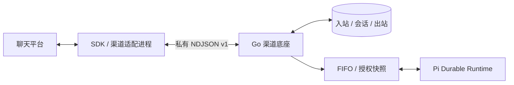

# 渠道适配器开发与安装

平台渠道底座只处理标准化入站、会话、Agent 任务和出站状态。每个适配器负责厂商 SDK、连接维护、消息格式和回执分类。随系统分发的企微智能机器人与自建应用均以渠道插件注册。机器人运行在独立 Node 进程，自建应用使用宿主内的 Webhook 插件；两者都通过同一 `Provider` 接口接入，与模型 Runtime 分开。



`internal/channels` 定义 `Provider`、`Connection`、`Incoming`、`Delivery` 和注册表；`internal/platform/channel_core.go` 复用业务队列与持久化；`channels.go` 提供统一管理 API。适配器不需要接触平台数据库或实现 Agent 引擎。

## 随系统分发的插件

`internal/channels` 提供 `Plugin` 工厂、`Provider` 收发接口和可选的 `WebhookProvider` / `CredentialTester` 接口。`internal/channelplugins/bundled.go` 是默认插件清单，负责组装以下插件：

| 插件 | 位置 | 职责 |
| --- | --- | --- |
| `wecom-bot` | `internal/channelplugins/wecombot/`、`runtime/src/plugins/wecom-bot/worker.ts` | 字段声明、官方 SDK 长连接、消息标准化、流式回复与回执 |
| `feishu-bot` | `internal/channelplugins/feishubot/`、`runtime/src/plugins/feishu-bot/worker.ts` | 字段声明、官方 SDK 长连接、事件标准化、卡片原地更新与资源下载 |
| `weixin` | `internal/channelplugins/weixin/` | 字段声明、ilink 长轮询、扫码登录凭据、消息/图片/引用解析、媒体解密与发送分类 |
| `qqbot` | `internal/channelplugins/qqbot/`、`runtime/src/plugins/qqbot/worker.ts` | 字段声明、QQ Bot API v2 网关（认证/心跳/重连）、事件标准化、附件下载与被动回复 |
| `wecom-app` | `internal/channelplugins/wecomapp/` | 字段声明、凭据测试、回调签名/AES 校验、消息解析、访问凭据缓存与发送 |

三个进程插件（企微机器人、飞书、QQ）共用 `runtime/src/plugins/frames.ts` 的协议框架（行分帧、字节上限、关闭语义），各自的 worker 只负责厂商 SDK 与平台消息之间的转换。`-channel-worker` 仍指向企微机器人入口；其它内置进程插件从同一目录的 `plugins/<插件 ID>/worker.js` 加载，因此发布包无需为每个插件增加启动参数。

平台启动通过 `ConfigureChannelAdapters` 加载默认清单和数据目录的外部进程插件。自定义宿主可以在启动工作线程前调用 `ConfigureChannelPlugins(node, workerScript, plugins)` 选择其他插件集合；传入空集合可只加载外部进程插件。宿主内插件编译时随程序分发，新增此类插件需重新构建；外部 Node 进程插件按下节安装，无需修改平台代码或重新编译。

核心仅保存渠道配置、密钥、验证状态和消息，不直接引用企微 SDK、加解密或客户端。旧 `/api/wecom/*` 仅保留为通用管理接口的兼容转换层；历史迁移中仍保留旧表定义。`runtime/src/channel-wecom.ts` 仅作为既有启动路径的兼容入口，实际实现位于机器人插件目录。插件 ID、字段、旧回调 URL 和数据库结构保持兼容，无需重新录入渠道。

移除插件后，已有配置和历史仍保留，渠道显示“适配器未安装”，不能启用；恢复同 ID 插件后可继续使用原配置与去重记录。插件集合在启动前确定，运行中不支持热替换。

### Webhook 插件

宿主内插件实现 `WebhookProvider`：

```go
type WebhookProvider interface {
    CallbackPath(string) string
    ServeCallback(http.ResponseWriter, *http.Request, Config, Receive, func(context.Context) error)
}
```

`CallbackPath` 返回 `/callbacks/<namespace>/<channel-id>`。平台按渠道 ID 查找插件，并要求请求路径与该插件声明的路径完全一致；只开放 GET/POST。插件在 `ServeCallback` 中先验证厂商身份，再调用 `Receive` 保存标准化消息，或调用最后一个参数保存 URL 验证结果。接收成功后才能向厂商确认；保存失败必须返回失败状态。平台为整个请求设置 3 秒期限，消息入队与 URL 验证均绑定接收时的配置版本，旧配置不能覆盖新配置的验证状态。插件负责请求体上限与自己的协议校验。

平台不为缺失插件处理回调，也不将已归档渠道转交给插件。自建应用插件继续声明 `/callbacks/wecom/{id}`，既有公网 URL 不变。

## 安装包

额外适配器安装在数据目录的 `channel-adapters/<package>/`，包含 `adapter.json`、已准备好的 Node 入口和所需依赖。当前从本地可信目录在启动时发现；安装后重启整个服务，新类型会出现在“新增渠道”中。没有 Web 任意包下载或执行安装脚本的接口。清单或入口损坏的额外包会被跳过并记录固定错误说明，其余适配器与平台仍正常启动。

示例清单：

```json
{
  "v": 1,
  "entry": "worker.mjs",
  "provider": {
    "id": "example-chat",
    "name": "Example Chat",
    "description": "通过 SDK 长连接接收文字消息。",
    "documentation": "https://example.com/docs",
    "transport": "websocket",
    "identity_fields": ["account"],
    "max_text_bytes": 1800,
    "fields": [
      {"key":"account","label":"账号标识","required":true},
      {"key":"token","label":"访问密钥","secret":true,"required":true}
    ]
  }
}
```

`streaming: true` 表示可在同一消息 ID 下原地更新；`images: true` 表示能下载并暂存入站图片。两者都缺省为 `false`。

`id` 使用小写字母、数字与连字符，不能覆盖内置或其他已安装 ID。字段键使用小写字母、数字、下划线；最多 32 个字段。`identity_fields` 必须引用必填的普通配置字段，不能使用密钥。相同适配器的同一连接标识只允许一个未归档渠道。

配置值和密钥均为字符串，单值最多 8192 字节，不接受控制字符；序列化后的配置与密钥合计最多 128 KiB。字段 `type: "number"` 表示整数，保存时规范为十进制字符串；其他字段使用文本输入。密钥必须声明 `secret:true`，由平台加密保存、不回显；编辑时空值保留旧值。通用表单拒绝未知配置或将密钥放入普通配置。

`max_text_bytes` 在 256–20000 内，平台为多段编号预留空间。入口必须是包内相对路径，不接受绝对路径、上级路径及符号链接入口。单清单最多 64 KB，最多安装 32 个额外包。

适配器是以服务账户执行的**可信代码**，不是安全沙箱。部署前检查来源、许可证和固定的依赖版本；它与只供模型读取的 Skill 文件不同。平台不运行 `npm install` 或安装脚本。可在可信构建环境准备依赖，或明确使用 `npm ci --omit=dev --ignore-scripts`；如包需要构建，应在部署前完成。数据目录内安装代码与依赖要纳入完整停机备份。

## 进程协议 v1

平台通过 Node 可执行文件启动入口，无 Shell 拼接。工作目录为包目录；不继承平台模型/MCP 密钥、HOME、PATH 等环境，仅提供 `NODE_ENV=production`。使用 CLI `-node` 选择的 Node；入口和依赖应自包含。内置机器人入口通过 `-channel-worker` / `SIAGENT_CHANNEL_WORKER` 独立指定，默认 `runtime/dist/channel-wecom.js`，不跟随模型 `-runtime` 路径变化。

stdin/stdout 使用一行一个 JSON 对象，每帧 `v:1`，最多 256 KiB。stdout 只能写协议，不得打印日志或密钥；当前平台丢弃适配进程 stderr，也不会将供应商原始错误正文保存到管理诊断。

### 初始化与状态

平台发送：

```json
{"v":1,"type":"configure","config":{"id":"channel-id","provider":"example-chat","version":1,"config":{"account":"account-id"},"secrets":{"token":"private-value"},"media_dir":"/data/channel-media/channel-id/inbox"}}
```

`media_dir` 是平台为该渠道创建的私有上传目录，只有声明了 `images: true` 的适配器才需要使用。平台在建立连接前清空它，并在渠道归档时再次清空；适配器只能在其中写入普通文件。

适配器初始化 SDK 并异步连接，发出：

```json
{"v":1,"type":"status","state":"connecting"}
{"v":1,"type":"status","state":"connected"}
```

状态支持 `connecting`、`connected`、`reconnecting`、`disconnected`、`failed`。只有厂商认证成功后才能报告 `connected`。状态说明由平台生成，不转发原始 SDK 错误。连接检查会短暂启动一个未启用渠道的适配器，仅验证连接，不创建 Agent 任务。

进程和 SDK 必须在 stdin EOF 时退出并关闭连接。平台停用、配置更新和退出时会关闭进程及其进程组。异常退出不自动重放业务请求；SDK 可按自身策略恢复网络连接，必须避免重放未知业务发送。

### 标准化入站

```json
{"v":1,"type":"incoming","incoming":{"id":"vendor-message-id","session":"stable-conversation-scope","kind":"text","text":"用户问题","reply_context":{"request_id":"opaque-vendor-context"}}}
```

- `id`：渠道内稳定的厂商消息 ID，最多 256 字节，作为持久化去重标识。
- `session`：最多 2048 字节的稳定来源范围标识，不能以临时连接 ID 代替。
- `chat_type` / `sender_id` / `group_id`：支持群聊的适配器应提供这三个标准字段。`chat_type` 为 `single` 或 `group`；`sender_id` 为稳定成员 ID，群聊必须提供稳定 `group_id`，私聊的群 ID 为空。身份字段各最多 256 字节。平台生成稳定三元组 session，由 Agent 策略决定按群内成员或全群共享上下文。回复的 target 保持原成员来源，不被共享上下文键替换。
- 兼容旧企微 `[聊天类型, 群ID, 成员ID]` JSON session。只提供不透明 session 的旧适配器按私聊处理；群聊必须升级身份字段后才能使用类型限制和群共享。
- `kind`：`text` 或 `image`；其他类型形成明确的文字范围说明。
- `text`：UTF-8 文本，最多 100000 字节，仍受 Agent 的输入与上下文限制。
- `images`：可选，最多 8 项，每项 `{name, file}`。适配器必须先自行下载并解密图片，再写入 `configure.config.media_dir` 给出的目录，并在 `file` 中只填该目录内的文件基名；平台读一次即删除该文件，不接受路径、上级目录或符号链接。图片不放进协议帧：单帧上限 256 KiB，而单张图片允许 4 MiB。平台按内容检测格式与大小，通过后暂存到自己的目录，准入时转成该会话的普通对话附件（与 Web 附件同构）。清单声明 `images: true` 后平台才会接受 `images`；未声明时图片消息返回文字说明。
- `reply_context`：用于回复的厂商协议上下文，最多 16 项、序列化 8 KiB。作为业务数据持久化，清理会话时移除，不能在其中传入用于其他系统的凭据。

群聊示例：

```json
{"v":1,"type":"incoming","incoming":{"id":"message-2","chat_type":"group","sender_id":"member-1","group_id":"room-1","kind":"text","text":"团队问题","reply_context":{"request_id":"opaque-vendor-context"}}}
```

平台在入站提交或确认同内容重复后发送：

```json
{"v":1,"type":"receipt","id":"vendor-message-id","accepted":true}
```

收到 `accepted:false` 应停止或暂停接收，不能假装已保存。适配器若向上游发送应用层接收确认，应在平台确认提交后发送；各厂商协议不一定支持此能力，不能据此承诺跨系统恰好一次。

正文身份依据稳定 session/kind/text 计算，传输回复 request ID 的变化不产生新任务。适配器不直接调用模型，不重新执行工具，也不自己管理平台会话。

### 出站与回执

```json
{"v":1,"type":"send","id":"delivery-id","delivery":{"id":"delivery-id","inbox_id":"inbox-id","target":"stable-conversation-scope","text":"回答","kind":"final","part":0,"reply_context":{"request_id":"opaque-vendor-context"}}}
```

`kind` 为 `ack`、`hint`、`draft` 或 `final`，`part` 从 0 起。`ack` 是收到消息后的即时确认，`draft` 是作答过程中持续更新的已生成内容，`hint` 是 30/90 秒的排队或处理中提示，三者都必须保持消息未结束；只有 `final` 结束消息。若支持更新同一条消息，可用 `inbox_id + part` 生成稳定流式 ID，使确认、进度、提示与最终回答复用同一条消息。平台已经持久化发送尝试；适配器只发起一次 SDK 业务请求。

适配器在清单的 `provider` 中声明 `streaming: true` 才表示能在同一 ID 下原地更新同一条消息。声明后平台会按 Agent 配置发送即时确认与作答进度；未声明时只发送 `hint` 和 `final`，避免给每个问题增加一条独立消息。厂商对单条内容有字节上限或有效期时（例如企微流式消息约 10 分钟），适配器应自行按 `max_text_bytes` 拒绝超长内容，并在过期前切换到新的消息 ID。

```json
{"v":1,"type":"result","id":"delivery-id","result":{"state":"sent","code":0}}
```

| 状态 | 必须满足的条件 |
| --- | --- |
| `sent` | 已取得厂商明确成功回执 |
| `retry` | 尚未发出业务请求，或厂商明确以可重试错误拒绝 |
| `failed` | 明确拒绝且不宜自动重试 |
| `unknown` | 请求可能已发出，但未取得可信结果，包括超时与确认前断开 |

`id` 必须关联原 `send.id`。不能将超时、网络异常或无效回执当作明确失败；不要让 SDK 自动重发未知请求。平台统一限制重试、阻塞后续分段并提供人工核对。厂商数字错误码可返回，原始错误正文不返回；即使适配器带 `message`，平台也只保存对应的固定状态说明。

## 内置实现与验证

`runtime/src/plugins/wecom-bot/worker.ts` 是官方 SDK 的薄封装，包含认证、消息标准化、`replyStream` 调用、回执分类、背压上限和 EOF 清理。它不导入 Pi 模型或 Agent API。SDK 的网络重连与平台的业务重试相互独立。

`runtime/test/channel-wecom.test.mjs`、`runtime/test/channel-feishu.test.mjs` 与 `runtime/test/channel-qqbot.test.mjs` 分别使用真实企微/飞书 SDK、QQ 网关协议与本地协议服务验证订阅、回复、卡片更新、资源下载、错误分类与重连不重放。微信个人号以 Go 进程内长轮询实现，协议与凭据测试见 `internal/channelplugins/weixin/`。`TestInstalledProcessAdapterUsesCoreWithoutVendorSpecificRoutes` 安装一个独立清单及进程入口，通过同一管理 API、会话隔离、调度和投递流程运行，验证新增渠道不需要增加数据库表或专属配置页面。

OpenClaw、Pi Coding Agent 等工具的宿主插件接口与本协议不同。可复用其独立连接器或 SDK，另加薄协议封装；不能承诺直接安装任意宿主插件即可运行。

`TestWebhookPluginUsesGenericCoreAndVersionedVerification` 使用独立 Webhook 插件验证认证、路径分发、验证状态、去重、任务与出站，以及配置变更时拒绝过期验证。`TestBundledChannelPluginsCanBeOmittedAndRestored` 验证默认插件可不加载、缺失时保留配置和历史、恢复后不重复接收旧消息。
